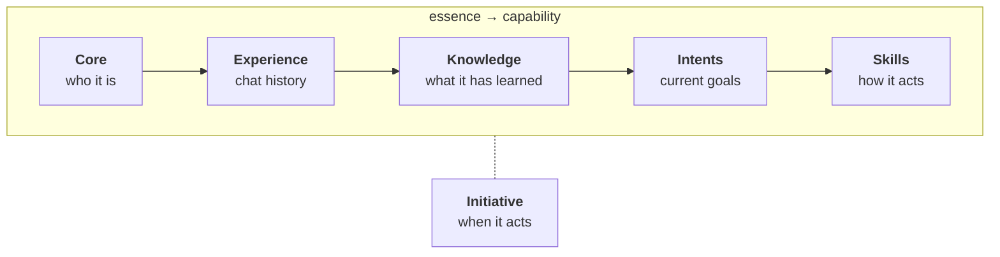

# Agents

An agent is a persistent AI personality. It carries identity, knowledge, and behaviour into every chat. The aim is a character that grows over time, not a fresh chat window every session.

## The Eigin agent ontology

An Eigin agent is built as a spectrum from **essence** to **capability** — from what the agent *is* to how it *acts*. Each layer rests on the ones below, and each is more changeable than the one beneath.

Reading left to right:

1. **[Core](./core.md)** — the agent's essence. Its identity, its view of the user, and the values it operates by, kept as persistent texts injected into every system prompt. The agent's *constitution*: the most fundamental, slowest-changing layer. Change here changes who the agent is.
2. **[Experience](./experience.md)** — what the agent has lived through. The chats it has had with the user, which it can browse, search, and read back. Experience is the raw record everything above is built on.
3. **[Knowledge](./knowledge.md)** — what the agent has learned. A structured graph of actors, things, facts, outputs, and notes, distilled from experience and from the world around the user.
4. **[Intents](./intents.md)** — what the agent is *trying* to do: its goals, the things on its mind. Self-set, built up from what the agent has noticed the user cares about. Intents are more ephemeral than the layers below — they have strength that decays over time and can be reinforced, resolved, or dismissed — but they're still part of who the agent is. **Intents direct the agent's capabilities.**
5. **[Skills](./skills.md)** — the ways the agent can *act* on its intents. Bundled instruction + tools, like knowledge, web, scheduling, email. The agent reaches for a skill because an intent or the user's immediate request calls for it. Some skills are always active; others activate on demand. The most surface-level layer: change a skill and the agent's behaviour changes immediately.

Sitting alongside this spectrum is **[Initiative](./initiative.md)** — not a layer of what the agent *is*, but a setting for how proactively it operates. Initiative governs *when* the rest of the stack runs.

## System prompt assembly

The system prompt is built dynamically on every chat turn by combining:

1. Agent presentation
2. Identity and Soul cores ("about you")
3. User core ("about the user")
4. Space context, if the chat is within a [space](../conversation/spaces.md)
5. Active skills' instructions
6. Essential tool instructions
7. Technical notes (explaining metadata the agent may see in chat)

Because the prompt is rebuilt each turn, changes to core texts, active skills, or the active space take effect immediately.
