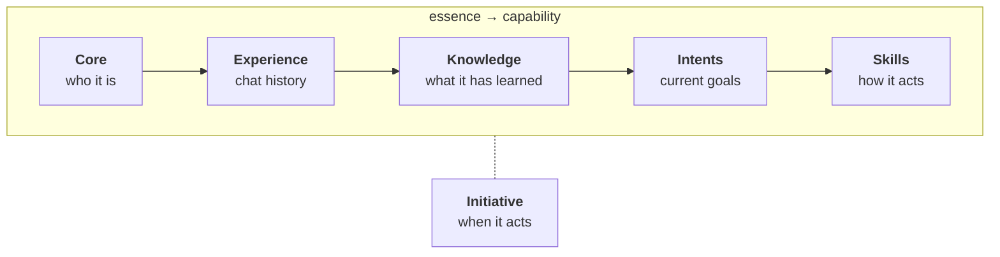

# Agents

An agent is a persistent AI personality, carrying identity, knowledge, and behaviour into every chat. The aim is a character that grows over time, not a fresh window every session.

## The agent ontology

An agent runs from **essence** to **capability**: what it *is* through how it *acts*. Each layer rests on the ones below and changes more readily than the one beneath.

| Layer | What it is |
|---|---|
| **[Core](./core.md)** | *Who it is.* Identity, its view of the user, and its values. The slowest-changing layer: change it and you change who the agent is. |
| **[Experience](./experience.md)** | *Chat history.* The chats it can browse, search, and read back, the raw record the rest is built on. |
| **[Knowledge](./knowledge.md)** | *What it has learned.* A structured graph of actors, things, facts, outputs, and notes, distilled from experience. |
| **[Intents](./intents.md)** | *Current goals.* Self-set from what it notices you care about; they direct its focus. |
| **[Skills](./skills.md)** | *How it acts.* Bundled instructions and tools; some always active, others on demand. |

Alongside the spectrum, **[Initiative](./initiative.md)** sets *when* the agent acts: how proactively it operates, governing when the rest of the stack runs.

## System prompt assembly

The system prompt is stable across turns: it holds the agent's essence and fundamental context about Eigin. Dynamic context (active skills, intents, interaction mode, space) is injected per-turn via system hints. See [The gatekeeper](../conversation/context.md).
