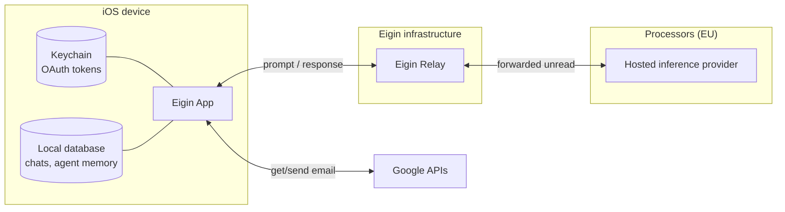

# CASA self-assessment

| Version | Date | Author | Status |
|---|---|---|---|
| 0.1 | 2026-08-19 | Daniel Rothmann | Draft |
| 0.2 | 2026-08-22 | Daniel Rothmann | Draft |
| 1.0 | 2026-08-24 | Daniel Rothmann | Final |
| 1.1 | 2026-09-02 | Daniel Rothmann | Final. System context moved to the shared overview |

## Introduction

Eigin is a local-first personal AI app. The agent, its memory, and its tool calls execute on the user's device. The App can run an AI model on-device, or send conversations to a hosted inference service.

This document is our self-assessment against the [CASA Specification](https://github.com/appdefensealliance/ASA-WG/blob/main/CASA/CASA%20Specification.md) v2.1.1. It describes our system, what is in scope, and makes a claim for each CASA requirement.

The assessment has been independently validated by TAC Security, an authorised CASA lab, which issued our letter of validation.

## System context

See the shared [system context](./README.md#system-context) for components and dependencies.

## Scope

CASA assesses web apps and web-accessible APIs. Eigin doesn't publish a web app, and the **Eigin Relay is the only web-accessible API we operate**, so it is the target application. 

Source is at [`src/eigin_relay/`](https://code.eigin.ai/dev/eigin/-/tree/main/src/eigin_relay). Its deployment is declared as Terraform at [`infra/scaleway/`](https://code.eigin.ai/dev/eigin/-/tree/main/infra/scaleway). The claims below are based on the code that produces the running service.

The App is a mobile client, so it falls under the mobile specification rather than this one. It appears in claims primarily for the OAuth authorization it performs.

| Component | In scope | Why |
|---|---|---|
| Eigin Relay | Yes | The target application, including every route it serves |
| Relay database | Yes | First-party infrastructure used by the target application. Stores AI credit tokens |
| App OAuth flow | Requirements 3.2.x | The authorization the App performs ([`PKCEOAuthFlow.swift`](https://code.eigin.ai/dev/eigin/-/blob/main/src/eigin_ios/Sources/Core/Foundation/OAuth/PKCEOAuthFlow.swift)) |
| Hosted inference providers | Sections 1 to 3 | Called by the Relay. Receive conversation content |
| Web search provider | Sections 1 to 3 | Used by the Relay. Queries are agent-composed and gated by user approval, with the query disclosed |
| Connected account providers | No | Called by the App, not by the Relay. The authorization Eigin performs against them is assessed under 3.2.x |
| Apple App Store | No | The Relay doesn't call Apple APIs. Its refund notifications arrive inbound on a Relay webhook, covered in [Annex B](#annex-b-apple-webhook) |

## Requirements

The Relay supports a local-first app. It provides capabilities an agent cannot perform locally such as those needing a server-side key or a stable endpoint. 

It is built on a privacy-preserving design, without direct user identity or retention of user data. Prompts and responses remain unread and unlogged ([Annex A](#annex-a-user-data)). 

The main auth mechanism is a credit wallet, backed by a cryptographically signed purchase and addressed by a bearer token that authorizes spend without identifying the person. See [Eigin Relay](../relay.md).

Sections 1 and 2 are therefore largely not applicable.

### 1. Authentication

| Req | Verdict | Evidence |
|---|---|---|
| 1.1.1 – 1.1.3 | N/A | No user authentication service, proprietary or external, and no passwords. The only credential is a bearer credit token, which authorizes spend rather than identifying a user; guessing is infeasible (256-bit CSPRNG, section 2) and all routes are rate limited (3.1.5) |
| 1.2.1 | Met | No accounts or default credentials exist, so none are present on any exposed interface |
| 1.3.1 – 1.3.4 | N/A | No out-of-band verifiers; no email, SMS, or reset flows |

### 2. Session management

The only credential is a per-wallet credit token from `POST /v1/credits/redeem`: 256 bits of CSPRNG entropy, looked up by SHA-256 digest, encrypted at rest with ChaCha20-Poly1305 ([`token.rs`](https://code.eigin.ai/dev/eigin/-/blob/main/src/eigin_relay/src/credits/token.rs), [`bearer.rs`](https://code.eigin.ai/dev/eigin/-/blob/main/src/eigin_relay/src/auth/bearer.rs)).

| Req | Verdict | Evidence |
|---|---|---|
| 2.1.1 | Met | Credentials travel in headers only. No route accepts a token as a query parameter |
| 2.2.1 | N/A | No login or logout exists. A wallet can be revoked server-side, and its token is refused from the next request |
| 2.2.2 | N/A | No passwords |
| 2.2.3 | N/A | Tokens are stateful and revocable at any time |
| 2.3.1, 2.3.2 | N/A | No cookies are set or read |
| 2.3.3 | Met | Authorization uses per-wallet revocable tokens, 256 bits of CSPRNG generated at redemption ([`token.rs`](https://code.eigin.ai/dev/eigin/-/blob/main/src/eigin_relay/src/credits/token.rs)). The static `x-eigin-key` is not a credential: it filters untargeted internet traffic and, since it ships in the app binary and is extractable, is not treated as a secret ([`key.rs`](https://code.eigin.ai/dev/eigin/-/blob/main/src/eigin_relay/src/auth/key.rs)) |
| 2.3.4 | N/A | Tokens are opaque random values carrying no claims |
| 2.4.1 | Met | Redemption requires a verified Apple transaction JWS ([`single.rs`](https://code.eigin.ai/dev/eigin/-/blob/main/src/eigin_relay/src/credits/apple/single.rs)) or an Ed25519-signed grant; spend requires the bearer token on every request. No account modifications exist. Sandbox transactions verify identically, in separate capped wallets |

### 3. Access control

There is one role: the bearer of a credit token, able to act only on its own wallet. Every decision is server-side. The OAuth flow performed by the App is assessed under 3.2.x.

| Req | Verdict | Evidence |
|---|---|---|
| 3.1.1 | Met | Every gated route requires the bearer token, enforced server-side before any handler runs ([`router.rs`](https://code.eigin.ai/dev/eigin/-/blob/main/src/eigin_relay/src/router.rs)). The database is reached through a project-scoped IAM service account with a single permission set ([`database.tf`](https://code.eigin.ai/dev/eigin/-/blob/main/infra/scaleway/modules/relay/database.tf)) |
| 3.1.2 | Met | Balance, status, and pricing derive from the ledger and server-side config. No client-supplied value affects authorization |
| 3.1.3 | Met | Access checks fail closed: missing, unparseable, or unknown input returns 401 or 500, never a pass ([`error.rs`](https://code.eigin.ai/dev/eigin/-/blob/main/src/eigin_relay/src/error.rs)). The Apple webhook acknowledges invalid payloads with 200 but discards them unprocessed ([Annex B](#annex-b-apple-webhook)) |
| 3.1.4 | Met | No route takes a path parameter or object ID, and no query parameter names an object ([`api.yaml`](https://code.eigin.ai/dev/eigin/-/blob/main/src/eigin_relay/api.yaml)). Wallets are addressed solely by the bearer's own token hash |
| 3.1.5 | Met | No cookies or browser session, so no CSRF surface. A per-IP sliding window covers every gated route and `/docs` by default ([`rate_limit.rs`](https://code.eigin.ai/dev/eigin/-/blob/main/src/eigin_relay/src/rate_limit.rs), [`router.rs`](https://code.eigin.ai/dev/eigin/-/blob/main/src/eigin_relay/src/router.rs)), with the client IP derived via a trusted-hop count ([`client_ip.rs`](https://code.eigin.ai/dev/eigin/-/blob/main/src/eigin_relay/src/client_ip.rs)). Inference adds a per-token window and search a rolling quota ([`quota/`](https://code.eigin.ai/dev/eigin/-/tree/main/src/eigin_relay/src/quota)). `/health` is excluded for Scaleway's probe; the Apple webhook keeps its own retry-cadence limiter. Deployed limits: [`container.tf`](https://code.eigin.ai/dev/eigin/-/blob/main/infra/scaleway/modules/relay/container.tf) |
| 3.1.6 | Met | Every route is explicitly declared. No filesystem directory is served |
| 3.2.1 | Met | Authorization Code with PKCE (S256) in `ASWebAuthenticationSession` ([`PKCEOAuthFlow.swift`](https://code.eigin.ai/dev/eigin/-/blob/main/src/eigin_ios/Sources/Core/Foundation/OAuth/PKCEOAuthFlow.swift)). No Implicit, no ROPC |
| 3.2.2 | Met | `state` is generated per authorization and validated before code exchange; the callback scheme derives from the configured `redirect_uri`, so the two cannot drift ([`PKCEOAuthFlow.swift`](https://code.eigin.ai/dev/eigin/-/blob/main/src/eigin_ios/Sources/Core/Foundation/OAuth/PKCEOAuthFlow.swift)) |
| 3.3.1 | N/A | The Relay exposes no administrative interface. Infrastructure and source control are administered through their own consoles, with MFA enforced on both |

### 4. Communications

TLS terminates at the Scaleway edge. All cryptography comes from vetted libraries.

| Req | Verdict | Evidence |
|---|---|---|
| 4.1.1 | Met | TLS enforced declaratively: `http_option = "redirected"` redirects plaintext rather than serving it ([`container.tf`](https://code.eigin.ai/dev/eigin/-/blob/main/infra/scaleway/modules/relay/container.tf)). Qualys SSL Labs grades both endpoints A, offering only TLS 1.3 and 1.2 with forward-secret AEAD suites ([IPv4](./evidence/ssllabs-relay.eigin.ai-ipv4-2026-08-18.pdf), [IPv6](./evidence/ssllabs-relay.eigin.ai-ipv6-2026-08-18.pdf)). Responses carry HSTS and other security headers ([`security/`](https://code.eigin.ai/dev/eigin/-/blob/main/src/eigin_relay/src/security/mod.rs)) |
| 4.1.2 | Met | Inbound certificates provisioned and rotated by Scaleway. SSL Labs reports a trusted Let's Encrypt chain with no chain issues ([IPv4](./evidence/ssllabs-relay.eigin.ai-ipv4-2026-08-18.pdf), [IPv6](./evidence/ssllabs-relay.eigin.ai-ipv6-2026-08-18.pdf)). Outbound uses `reqwest` against the system trust store. No private CAs, and verification is never disabled |
| 4.1.3 | Met | SHA-256 digests; ChaCha20-Poly1305 at rest, nonce derived per token with the uniqueness argument in [`token.rs`](https://code.eigin.ai/dev/eigin/-/blob/main/src/eigin_relay/src/credits/token.rs); ES256 against pinned Apple roots ([`single.rs`](https://code.eigin.ai/dev/eigin/-/blob/main/src/eigin_relay/src/credits/apple/single.rs)); Ed25519 for grants. Tokens and the 32-byte key come from a CSPRNG ([`secrets.tf`](https://code.eigin.ai/dev/eigin/-/blob/main/infra/scaleway/modules/relay/secrets.tf)). No MD5, SHA-1, DES, or RC4. Key storage and rotation: [Annex C](#annex-c-secrets) |
| 4.1.4 | Met | AEAD, so decryption failures are authentication failures and there is no padding to oracle. `decrypt` returns an opaque error ([`token.rs`](https://code.eigin.ai/dev/eigin/-/blob/main/src/eigin_relay/src/credits/token.rs)) |

### 5. Data validation and sanitization

The Relay accepts JSON bodies and three typed query parameters. It renders no HTML, executes no shell, reads no user-specified file, and parses no XML.

| Req | Verdict | Evidence |
|---|---|---|
| 5.1.1 | Met | Parameters deserialize into typed structs via `serde`; duplicates resolve deterministically |
| 5.1.2 | Met | No application route issues a redirect. The only redirect is the edge's plaintext-to-HTTPS upgrade (4.1.1), whose destination is fixed and carries no user input |
| 5.1.3 | Met | No `eval` equivalent; no dynamic code loading |
| 5.1.4 | Met | No template engine |
| 5.1.5 | Met | Outbound destinations come from deploy-time config only ([`config/`](https://code.eigin.ai/dev/eigin/-/tree/main/src/eigin_relay/config)). `model` selects among pre-registered clients by catalog lookup; unknown values are rejected. No user input selects a host or path |
| 5.1.6 | N/A | No XML or XPath parsing |
| 5.1.7 | Met | JSON and SSE only. The single HTML response, `/docs`, is static, reflects no user input, and carries a CSP ([`security/`](https://code.eigin.ai/dev/eigin/-/blob/main/src/eigin_relay/src/security/mod.rs)) |
| 5.1.8 | Met | All queries are `sqlx` prepared statements with bound parameters ([`postgres.rs`](https://code.eigin.ai/dev/eigin/-/blob/main/src/eigin_relay/src/credits/postgres.rs)) |
| 5.1.9 | Met | No process spawning |
| 5.1.10 | Met | No user input reaches a filesystem path. Config paths are environment variables read at startup |
| 5.2.1 | N/A | No file upload endpoint. Bodies capped at 10 MB |

### 6. Configuration

The Relay is a single container built from a pinned base and configured entirely through Terraform-declared environment and secrets.

| Req | Verdict | Evidence |
|---|---|---|
| 6.1.1 | Met | `just security` audits both Rust lockfiles with `cargo audit` and scans the built image and Dockerfile with Trivy ([`security.rs`](https://code.eigin.ai/dev/eigin/-/blob/main/tools/src/security.rs)). Relay dependencies and the Alpine base scan clean; the single suppressed advisory is justified in [`audit.toml`](https://code.eigin.ai/dev/eigin/-/blob/main/src/eigin_relay/.cargo/audit.toml) |
| 6.2.1 | Met | Release build from a pinned base ([`Dockerfile`](https://code.eigin.ai/dev/eigin/-/blob/main/src/eigin_relay/Dockerfile)). Tracing is filtered to `eigin_relay=info`, and errors return fixed messages with detail kept in server logs |
| 6.3.1 | Met | Authorization reads `x-eigin-key` and `Authorization` only. `Origin` is never consulted |
| 6.4.1 | Met | Every name in the zone resolves to a Scaleway resource in our own project or to Proton for mail. No third-party or unclaimed targets, and zone transfer is refused. Record set from `scw dns record list`, provided on request |
| 6.5.1 | Met | No credentials or payment details are logged; payment runs through Apple, so card data never reaches the Relay. Tokens persist only as SHA-256 digest and ciphertext, and the `eict_` prefix makes any leaked token detectable by secret scanners |
| 6.6.1 | N/A | No browser storage. Native client; secrets live in the Keychain |
| 6.7.1 | Met | Secrets are separated from settings, generated rather than authored, stored encrypted by Scaleway, kept out of the repository, and access is monitored. Described in [Annex C](#annex-c-secrets) |

### Third-party APIs

The third-party APIs the Relay calls are the hosted inference providers and the Staan search API. They are assessed against sections 1 to 3 only.

| Req | Verdict | Evidence |
|---|---|---|
| Section 1 | N/A | Neither provider gives Eigin a user account, a password, or a recovery flow. Each is reached with a single service credential |
| Section 2 | N/A | No sessions are established. Every request carries its own credential; nothing is negotiated, stored, or reused across calls |
| Section 3 | Met | Provider credentials are held server-side only, injected as `secret_environment_variables` ([`container.tf`](https://code.eigin.ai/dev/eigin/-/blob/main/infra/scaleway/modules/relay/container.tf)) and never sent to the App. Destinations come from deploy-time config, so no client input selects a provider (5.1.5) |

Onward transfer terms for the inference providers are recorded under [Onward transfer](#onward-transfer).

## Annex A: User data

Integrations let the user bring their own content into a chat with their agent. Eigin supports integrations with Google, Microsoft, MCP servers, and more. Integrations follow the same implementation pattern, and Google data is used here as the primary example, covering the [Google API Services User Data Policy](https://developers.google.com/terms/api-services-user-data-policy).

### Google scopes

Eigin requests two restricted scopes: `gmail.readonly`, to read messages the user asks the agent about, and `gmail.send`, to send messages the user asks it to send.

### Data flow

Gmail is read and sent on the device. Gmail *content* can reach the Relay, because tool results are added to the conversation before it is sent for inference.

- **Credentials don't leave the device.** OAuth tokens are stored on the iOS Keychain and only used locally.
- **The Relay doesn't read prompts.** It parses `model` and `stream`, forwards the rest unread, and scans responses only for token usage ([`handler.rs`](https://code.eigin.ai/dev/eigin/-/blob/main/src/eigin_relay/src/inference/handler.rs), [`usage.rs`](https://code.eigin.ai/dev/eigin/-/blob/main/src/eigin_relay/src/inference/usage.rs)).
- **Zero Data Retention.** No prompt or response content is logged, stored, or traced. Only token counts persist, to settle billing.
- **No user identity exists.** A Relay credit wallet is keyed by a SHA-256 hash of an In-App-Purchase.
- **On-device inference bypasses all of this.** If the user chooses a local model, prompts don't leave the device.

### Onward transfer

Forwarding Gmail content to an inference provider is a transfer of Google user data. Our inference providers are EU-based and bound by a DPA.

| Provider | Location | No retention | No training | No human review |
|---|---|---|---|---|
| [TensorX](https://tensorx.ai/dpa/) | Dublin, Helsinki | DPA §3.2 | DPA §3.2 | Ephemeral enclaves |
| [Mistral](https://legal.mistral.ai/terms/data-processing-addendum) | France | Org-level ZDR | Follows from ZDR | See the [Trust Center](https://trust.mistral.ai/) |
| [Corti](https://www.corti.ai/legal/terms-and-conditions) | Denmark | Terms: zero retention | Follows from zero retention | See the [trust center](https://app.drata.com/trust/9cc6d701-0c38-11ee-865f-029d78a187d9) |

Google user data is never used for advertising or model training. See the [privacy policy](https://www.eigin.ai/privacy/).

### Other destinations

Those transfers are designed. Every other destination is reached through a tool the agent calls, and the agent composes its own arguments. Because a model can paraphrase around any content filter, the control is containment rather than filtering:

- **The destination set is fixed.** Data leaves only through a declared tool.
- **External tools ask first.** Web search, web fetch, and MCP servers are `ask` by default ([permissions](../tools/permissions.md)).
- **The prompt shows the arguments,** so the user reviews content rather than a tool name.
- **A tool can be removed.** `never` hides it from the agent entirely.

Web search reaches one provider, Staan. MCP servers are added by the user and gated by the same approval.

## Annex B: Apple webhook

`POST /webhooks/apple/appstore` carries App Store refund events ([`webhook.rs`](https://code.eigin.ai/dev/eigin/-/blob/main/src/eigin_relay/src/credits/apple/webhook.rs)).

**Unauthenticated by design.** Apple cannot present a credential, so the ES256 signature is used for authentication (4.1.3). Verification precedes any ledger access, so a forged payload reaches no wallet.

**Replay** is bounded by a `signedDate` freshness window and by `notificationUUID` deduplication, which admits each notification once.

**200 on failure by design.** Apple retries non-2xx, and a payload that will never validate should not be retried forever.

## Annex C: Secrets

**Separation.** Non-secret settings are plain `environment_variables`. Secrets are `secret_environment_variables`, which Scaleway stores encrypted and never returns through the console or API ([`container.tf`](https://code.eigin.ai/dev/eigin/-/blob/main/infra/scaleway/modules/relay/container.tf)).

**Origin.** Secrets we mint are automatically generated with Terraform: 32 random bytes for the token encryption key, a 32-character random relay key, an Ed25519 grant keypair ([`secrets.tf`](https://code.eigin.ai/dev/eigin/-/blob/main/infra/scaleway/modules/relay/secrets.tf)). Provider API keys come from an untracked `.env`, since only their issuer can create them.

**Database.** Terraform creates a dedicated IAM application. Its API key is scoped to that database alone, so no credential is shared.

**State.** Generated secrets live in Terraform state, in a private, versioned Object Storage bucket in a dedicated project, reached only by a project-scoped IAM key, and configured through an untracked `backend.tf` (see the [remote state runbook](../runbooks/terraform-remote-state.md)). One set per workspace, so staging and production never share a value.

**Nothing committed.** `.env`, `backend.tf`, and local signing keys are all ignored. The registry is private.

**Monitoring.** Scaleway Audit Trail records IAM and database events for the organization, always on. Injected secrets are write-only — the console and API never return them — so the monitored surface is the IAM credentials able to replace them.

**Rotation.** Every secret can be rotated. The relay key accepts a previous value alongside the current one, so shipped clients keep working during a change. The grant keypair and the token encryption key are replaced in place.
