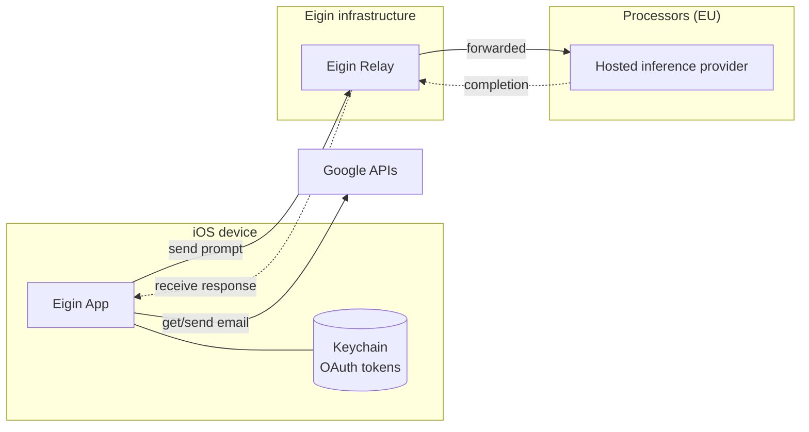

# CASA self-assessment

| Version | Date | Author | Status |
|---|---|---|---|
| 0.1 | 2026-08-19 | Daniel Rothmann | Draft |

## Introduction

Eigin is a personal AI assistant that runs as a native iOS app. The agent, its memory, and its tool calls execute on the user's device. The App can run a model entirely on-device, or send a conversation to a hosted model through a first-party service we operate.

This document is our self-assessment against every requirement of the [CASA Specification](https://github.com/appdefensealliance/ASA-WG/blob/main/CASA/CASA%20Specification.md) v2.1.1. It describes the system, states what is in scope and why, and makes a claim for each of the 48 requirements with a link to the code or configuration as evidence.

## System context

Eigin consists of three main components: the App, the Relay, and the database.

| Component | What it is |
|---|---|
| **Eigin App** | Native iOS client. Runs the agent and its tools against a local or hosted model, and holds credentials for connected accounts |
| **Eigin Relay** | Rust API, deployed as a container on Scaleway. Proxies inference and search, manages inference credits, and integrates with the App Store |
| **Relay database** | Scaleway Serverless SQL ([`database.tf`](https://code.eigin.ai/dev/eigin/-/blob/main/infra/scaleway/modules/relay/database.tf)). Stores inference wallets, usage quotas, and processed notification IDs |

The system depends on these external services:

| Dependency | Relationship |
|---|---|
| **Hosted inference providers** | Mistral, TensorX, and Berget. Serve the hosted models |
| **Connected account providers** | Third-party accounts the user connects directly in the App |
| **Web search provider** | Mojeek search API, proxied through the Relay |
| **Apple App Store** | Sells credit packs and notifies of refunds |

## Scope

CASA assesses web applications and web-accessible APIs. Eigin publishes no web application, and the **Eigin Relay is the only web-accessible API we operate**, so it is the target application. Source is at [`src/eigin_relay/`](https://code.eigin.ai/dev/eigin/-/tree/main/src/eigin_relay); its deployment is declared as Terraform at [`infra/scaleway/`](https://code.eigin.ai/dev/eigin/-/tree/main/infra/scaleway), so the configuration claims below are read from the code that produces the running service.

The App is a native iOS client, not a web application, so it falls under the mobile specification rather than this one. It appears below only for the OAuth authorization it performs.

| Component | In scope | Why |
|---|---|---|
| Eigin Relay | Yes | The target application, including every route it serves |
| Relay database | Yes | First-party infrastructure used by the target application. Stores the credit tokens |
| App OAuth flow | Requirements 3.2.x | The authorization the App performs ([`PKCEOAuthFlow.swift`](https://code.eigin.ai/dev/eigin/-/blob/main/src/eigin_ios/Sources/Core/Foundation/OAuth/PKCEOAuthFlow.swift)) |
| Hosted inference providers | Sections 1 to 3 | Called by the Relay. Receive conversation content |
| Web search provider | Sections 1 to 3 | Called by the Relay. Queries are composed by the agent and may carry user content |
| Connected account providers | No | Called by the App, never by the Relay. The authorization Eigin performs against them is assessed under 3.2.x |
| Apple App Store | No | The Relay calls no Apple API. Its refund notifications arrive on a Relay route, covered in [Annex B](#annex-b-apple-webhook) |
| `staging.relay.eigin.ai` | No | A development deployment of the same code in a separate Scaleway project, with its own database, secrets, and IAM. It serves no end users and accepts Apple sandbox transactions only |

## Requirements

The Relay supports a local-first app. It brokers the capabilities an agent cannot perform on device, those needing a server-side key or a stable endpoint, and meters what they cost. There are no user accounts, passwords, or user data: only a credit wallet carrying no identity, and a usage quota. See [Eigin Relay](../relay.md).

Sections 1 and 2 are largely not applicable: there is no identity to authenticate and no session to manage. Every claim gives its reason.

### 1. Authentication

| | | |
|---|---|---|
| 1.1.1 – 1.1.3 | N/A | No user authentication service, proprietary or external, and no passwords. The only credential is a bearer credit token, which authorizes spend rather than identifying a user; see section 2 |
| 1.2.1 | N/A | No default or built-in accounts |
| 1.3.1 – 1.3.4 | N/A | No out-of-band verifiers; no email, SMS, or reset flows |

### 2. Session management

The only credential is a per-wallet credit token from `POST /v1/credits/redeem`: 256 bits of CSPRNG entropy, looked up by SHA-256 digest, encrypted at rest with ChaCha20-Poly1305 ([`token.rs`](https://code.eigin.ai/dev/eigin/-/blob/main/src/eigin_relay/src/credits/token.rs), [`bearer.rs`](https://code.eigin.ai/dev/eigin/-/blob/main/src/eigin_relay/src/auth/bearer.rs)).

| | | |
|---|---|---|
| 2.1.1 | Met | Credentials travel in headers only. No route accepts a token as a query parameter |
| 2.2.1 | N/A | No login or logout. A wallet is revoked by status, failing the next admit check |
| 2.2.2 | N/A | No passwords |
| 2.2.3 | N/A | Tokens are stateful and revocable at any time |
| 2.3.1, 2.3.2 | N/A | No cookies are set or read |
| 2.3.3 | Met | No sessions exist, so no session tokens. Authorization uses a per-wallet credit token, 256 bits of CSPRNG generated at redemption ([`token.rs`](https://code.eigin.ai/dev/eigin/-/blob/main/src/eigin_relay/src/credits/token.rs)). The static `x-eigin-key` is an anti-abuse filter that authorizes nothing; it ships in the app binary and is not treated as a secret, and rotates via a secondary key ([`key.rs`](https://code.eigin.ai/dev/eigin/-/blob/main/src/eigin_relay/src/auth/key.rs)) |
| 2.3.4 | N/A | Tokens are opaque random values carrying no claims |
| 2.4.1 | Met | Redemption requires a verified Apple transaction JWS or an Ed25519-signed grant. Sandbox transactions verify identically and are scoped to their own wallets under a separate budget cap, for TestFlight. No account modifications exist |

### 3. Access control

The Relay has no user-facing authorization surface of its own: every decision is server-side and scoped to the bearer's own wallet. The only user-facing authorization flow in the system is the OAuth grant the App performs against a connected account provider.

| | | |
|---|---|---|
| 3.1.1 | Met | Enforced server-side in Tower middleware and an Axum extractor; routes gated in `build_router` ([`main.rs`](https://code.eigin.ai/dev/eigin/-/blob/main/src/eigin_relay/src/main.rs)). The database is reached through a project-scoped IAM service account with one permission set and a one-year key ([`database.tf`](https://code.eigin.ai/dev/eigin/-/blob/main/infra/scaleway/modules/relay/database.tf)) |
| 3.1.2 | Met | Balance, status, and pricing derive from the ledger and server-side config. No client attribute affects authorization |
| 3.1.3 | Met | `AppError` defaults to denial: missing, unparseable, or unknown input returns 401 or 500, never a pass |
| 3.1.4 | Met | No route takes a path parameter or object ID, and the only user-supplied parameter is the search `q` ([`api.yaml`](https://code.eigin.ai/dev/eigin/-/blob/main/src/eigin_relay/api.yaml)). Wallets are addressed solely by the bearer's own token hash |
| 3.1.5 | Met | No cookies or browser session, so no CSRF surface. Authenticated and unauthenticated routes alike carry per-IP and per-token sliding windows plus a rolling quota ([`rate_limit.rs`](https://code.eigin.ai/dev/eigin/-/blob/main/src/eigin_relay/src/rate_limit.rs), [`quota/`](https://code.eigin.ai/dev/eigin/-/tree/main/src/eigin_relay/src/quota)), with deployed limits in [`container.tf`](https://code.eigin.ai/dev/eigin/-/blob/main/infra/scaleway/modules/relay/container.tf) |
| 3.1.6 | Met | Every route is explicitly declared. No filesystem directory is served |
| 3.2.1 | Met | Authorization Code with PKCE (S256) in `ASWebAuthenticationSession`. No Implicit, no ROPC |
| 3.2.2 | Met | `state` is generated per authorization and validated before code exchange. The callback scheme derives from the configured `redirect_uri`, so the two cannot drift |
| 3.3.1 | N/A | The Relay exposes no administrative interface. Infrastructure and source control are administered out of band, through consoles outside the application, with MFA enforced on both |

### 4. Communications

TLS terminates at the Scaleway edge. All cryptography comes from vetted libraries; the Relay implements no primitive of its own.

| | | |
|---|---|---|
| 4.1.1 | Met | TLS enforced declaratively: `http_option = "redirected"` redirects plaintext rather than serving it ([`container.tf`](https://code.eigin.ai/dev/eigin/-/blob/main/infra/scaleway/modules/relay/container.tf)). Qualys SSL Labs grades both endpoints A, offering only TLS 1.3 and 1.2 with forward-secret AEAD suites ([IPv4](./evidence/ssllabs-relay.eigin.ai-ipv4-2026-08-18.pdf), [IPv6](./evidence/ssllabs-relay.eigin.ai-ipv6-2026-08-18.pdf)). Responses carry security headers |
| 4.1.2 | Met | Inbound certificates provisioned and rotated by Scaleway. SSL Labs reports a trusted Let's Encrypt chain with no chain issues ([IPv4](./evidence/ssllabs-relay.eigin.ai-ipv4-2026-08-18.pdf), [IPv6](./evidence/ssllabs-relay.eigin.ai-ipv6-2026-08-18.pdf)). Outbound uses `reqwest` against the system trust store. No private CAs, and verification is never disabled |
| 4.1.3 | Met | SHA-256 digests; ChaCha20-Poly1305 at rest, nonce derived per token with the uniqueness argument in [`token.rs`](https://code.eigin.ai/dev/eigin/-/blob/main/src/eigin_relay/src/credits/token.rs); ES256 against pinned Apple roots ([`single.rs`](https://code.eigin.ai/dev/eigin/-/blob/main/src/eigin_relay/src/credits/apple/single.rs)); Ed25519 for grants. Tokens and the 32-byte key come from a CSPRNG ([`secrets.tf`](https://code.eigin.ai/dev/eigin/-/blob/main/infra/scaleway/modules/relay/secrets.tf)). No MD5, SHA-1, DES, or RC4 |
| 4.1.4 | Met | AEAD, so decryption failures are authentication failures. `decrypt` returns an opaque error ([`token.rs`](https://code.eigin.ai/dev/eigin/-/blob/main/src/eigin_relay/src/credits/token.rs)) |

### 5. Data validation and sanitization

The Relay accepts JSON bodies and three typed query parameters. It renders no HTML, executes no shell, reads no user-specified file, and parses no XML.

| | | |
|---|---|---|
| 5.1.1 | Met | Parameters deserialize into typed structs via `serde`; duplicates resolve deterministically |
| 5.1.2 | Met | The Relay issues no redirects |
| 5.1.3 | Met | No `eval` equivalent; no dynamic code loading |
| 5.1.4 | Met | No template engine |
| 5.1.5 | Met | Outbound destinations come from deploy-time config only ([`config/`](https://code.eigin.ai/dev/eigin/-/tree/main/src/eigin_relay/config)). `model` selects among pre-registered clients by catalog lookup; unknown values are rejected. No user input reaches a URL |
| 5.1.6 | N/A | No XML or XPath parsing |
| 5.1.7 | Met | JSON and SSE only. The single HTML response, `/docs`, is static and reflects no user input |
| 5.1.8 | Met | All queries are `sqlx` prepared statements with bound parameters ([`postgres.rs`](https://code.eigin.ai/dev/eigin/-/blob/main/src/eigin_relay/src/credits/postgres.rs)) |
| 5.1.9 | Met | No process spawning |
| 5.1.10 | Met | No user input reaches a filesystem path. Config paths are environment variables read at startup |
| 5.2.1 | N/A | No file upload endpoint. Bodies capped at 10 MB |

### 6. Configuration

The Relay is a single container built from a pinned base and configured entirely through Terraform-declared environment and secrets.

| | | |
|---|---|---|
| 6.1.1 | Met | `just security` audits both Rust lockfiles with `cargo audit` and scans the built image and Dockerfile with Trivy ([`security.rs`](https://code.eigin.ai/dev/eigin/-/blob/main/tools/src/security.rs)). Relay dependencies and the Alpine base scan clean; the single suppressed advisory is justified in [`audit.toml`](https://code.eigin.ai/dev/eigin/-/blob/main/src/eigin_relay/.cargo/audit.toml) |
| 6.2.1 | Met | Release build from a pinned Rust base onto minimal Alpine carrying only the binary, migrations, and config ([`Dockerfile`](https://code.eigin.ai/dev/eigin/-/blob/main/src/eigin_relay/Dockerfile)). Tracing filtered to `eigin_relay=info`; no handler logs bodies. Errors return fixed messages, with detail kept in logs |
| 6.3.1 | Met | Authorization reads `x-eigin-key` and `Authorization` only. `Origin` is never consulted |
| 6.4.1 | Met | Every name in the zone resolves to a Scaleway resource in our own project or to Proton for mail. No third-party or unclaimed targets, and zone transfer is refused. Record set from `scw dns record list`, provided on request |
| 6.5.1 | Met | No credentials or payment details logged. Tokens persist only as SHA-256 digest and ciphertext. The `eict_` prefix makes any leak detectable by secret scanners. There is no browser client, so nothing is retained in browser storage |
| 6.6.1 | N/A | No browser storage. Native client; secrets live in the Keychain |
| 6.7.1 | Met | Secrets are separated from settings, generated rather than authored, stored encrypted by Scaleway, and kept out of the repository. Described in [Annex C](#annex-c-secrets) |

### Third-party APIs

The third-party APIs the Relay calls are the hosted inference providers and the Mojeek search API. They are assessed against sections 1 to 3 only.

| | | |
|---|---|---|
| Section 1 | N/A | Neither provider gives Eigin a user account, a password, or a recovery flow. Each is reached with a single service credential |
| Section 2 | N/A | No sessions are established. Every request carries its own credential; nothing is negotiated, stored, or reused across calls |
| Section 3 | Met | Provider credentials are held server-side only, injected as `secret_environment_variables` ([`container.tf`](https://code.eigin.ai/dev/eigin/-/blob/main/infra/scaleway/modules/relay/container.tf)) and never sent to the App. Destinations come from deploy-time config, so no client input selects a provider (5.1.5) |

Onward transfer terms for the inference providers are recorded under [Google data](#google-data).

## Annex A: User data

Integrations let the user bring their own content into a chat with their agent. Eigin supports integrations with Google, Microsoft, MCP servers, and more. Integrations follow the same implementation pattern, and Google data is used here as the primary example, covering the [Google API Services User Data Policy](https://developers.google.com/terms/api-services-user-data-policy).

### Google scopes

Eigin requests two restricted scopes: `gmail.readonly`, to read messages the user asks the agent about, and `gmail.send`, to send messages the user asks it to send.

### Data flow

Gmail is read and sent on the device. Gmail *content* can reach the Relay, because tool results are added to the conversation before it is sent for inference.

- **Credentials don't leave the device.** OAuth tokens are stored on the iOS Keychain and only used locally.
- **The Relay doesn't read prompts.** It parses `model` and `stream`, forwards the rest unread, and scans responses only for token usage ([`handler.rs`](https://code.eigin.ai/dev/eigin/-/blob/main/src/eigin_relay/src/inference/handler.rs), [`usage.rs`](https://code.eigin.ai/dev/eigin/-/blob/main/src/eigin_relay/src/inference/usage.rs)).
- **Zero Data Retention.** No prompt or response content is logged, stored, or traced. Only token counts persist, to settle billing.
- **No user identity exists.** A Relay credit wallet is keyed by a SHA-256 hash of an In-App-Purchase.
- **On-device inference bypasses all of this.** If the user chooses a local model, prompts don't leave the device.

### Onward transfer

Forwarding Gmail content to an inference provider is a transfer of Google user data. Our inference providers are EU-based and bound by a DPA.

| Provider | Location | No retention | No training | No human review |
|---|---|---|---|---|
| [TensorX](https://tensorx.ai/dpa/) | Dublin, Helsinki | DPA §3.2 | DPA §3.2 | Ephemeral enclaves |
| [Berget](https://berget.ai/en/dpa) | Sweden | ToS §7 | DPA §5.3 | DPA Appendix 1 |
| [Mistral](https://legal.mistral.ai/terms/data-processing-addendum) | France | Org-level ZDR | Follows from ZDR | See the [Trust Center](https://trust.mistral.ai/) |

Google user data is never used for advertising or model training. See the [privacy policy](https://www.eigin.ai/privacy/).

### Other destinations

Those transfers are designed. Every other destination is reached through a tool the agent calls, and the agent composes its own arguments. No app holding both data access and an outbound channel can guarantee user content never appears in one. Filtering does not close the gap: a model can paraphrase whatever a match would catch. The control is containment:

- **The destination set is fixed.** Data leaves only through a declared tool.
- **External tools ask first.** Web search, web fetch, and MCP servers are `ask` by default ([permissions](../tools/permissions.md)).
- **The prompt shows the arguments,** so the user reviews content rather than a tool name.
- **A tool can be removed.** `never` hides it from the agent entirely.

Web search reaches one provider, Mojeek. MCP servers are added by the user and gated by the same approval.

## Annex B: Apple webhook

`POST /webhooks/apple/appstore` carries App Store refund events ([`webhook.rs`](https://code.eigin.ai/dev/eigin/-/blob/main/src/eigin_relay/src/credits/apple/webhook.rs)).

**Unauthenticated by design.** Apple cannot present a credential, so the ES256 signature is used for authentication (4.1.3). Verification precedes any ledger access, so a forged payload reaches no wallet.

**Replay** is bounded by a `signedDate` freshness window and by `notificationUUID` deduplication, which admits each notification once.

**200 on failure by design.** Apple retries non-2xx, and a payload that will never validate should not be retried forever.

## Annex C: Secrets

**Separation.** Non-secret settings are plain `environment_variables`. Secrets are `secret_environment_variables`, which Scaleway stores encrypted and never returns through the console or API ([`container.tf`](https://code.eigin.ai/dev/eigin/-/blob/main/infra/scaleway/modules/relay/container.tf)).

**Origin.** Secrets we mint are automatically generated with Terraform: 32 random bytes for the token encryption key, a 32-character random relay key, an Ed25519 grant keypair ([`secrets.tf`](https://code.eigin.ai/dev/eigin/-/blob/main/infra/scaleway/modules/relay/secrets.tf)). Provider API keys come from an untracked `.env`, since only their issuer can create them.

**Database.** Terraform creates a dedicated IAM application. Its API key is scoped to that database alone, so no credential is shared.

**State.** Generated secrets live in Terraform state, in a private Object Storage bucket configured through an untracked `backend.tf`. One set per workspace, so staging and production never share a value.

**Nothing committed.** `.env`, `backend.tf`, and local signing keys are all ignored. The registry is private.

**Rotation.** Every secret can be rotated. The relay key accepts a previous value alongside the current one, so shipped clients keep working during a change. The grant keypair and the token encryption key are replaced in place.
