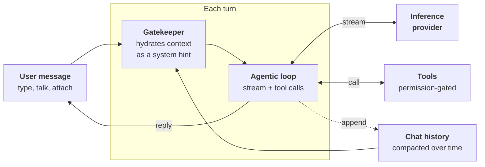

# Conversation

A conversation is a persistent sequence of messages between the user and the agent. The conversation system is the runtime that turns each user message into a reply, whether the user is typing, dictating, or on a live call.

Each turn, the [gatekeeper](./context.md) hydrates the user's message with dynamic context (active skills, intents, interaction mode, space) as a system hint. The [agentic loop](./agentic-loop.md) then streams a response from the [provider](../providers.md), running any [tool calls](../tools/permissions.md) until the reply is complete. The exchange is stored in the chat history, which feeds the next turn and is kept lean by [compaction](./compaction.md) as it grows.

## The pieces

| Piece | Role |
|---|---|
| [The agentic loop](./agentic-loop.md) | Drives the request → stream → tool-call → response cycle each turn. |
| [The gatekeeper](./context.md) | Hydrates each turn with dynamic context via the system hint. |
| [Compaction](./compaction.md) | Keeps context lean as the conversation grows. |
| [Spaces](./spaces.md) | Organise chats and isolate knowledge by domain. |
| [Attachments](./attachments.md) | Files a message can carry, images today. |
