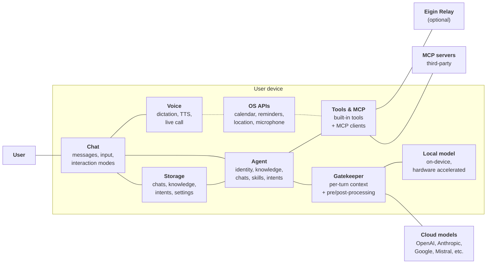

# System context

This page describes Eigin at the system level. For implementation details on a specific platform, see [iOS Implementation](./ios/README.md).

## The pieces

### Chat

Where the user meets the agent. A chat is a persistent sequence of messages; the user can type directly or dictate through the voice subsystem. Chats live in storage and can be grouped into [spaces](./conversation/spaces.md). See [Conversation](./conversation/README.md).

### The agent

A persistent AI personality with its own identity, knowledge, conversation history, and goals. A device runs one agent at a time. See [The Agent](./agents/README.md).

### Gatekeeper

Sits between the agent and the inference provider. Hydrates each turn with dynamic context (skills, intents, interaction mode, space, hints) and is the seam for future input/output safety work. See [The gatekeeper](./conversation/context.md).

### Storage

Chats, knowledge, intents, settings, and provider configuration live on the device.

### Voice

The voice subsystem handles on-device speech recognition, text-to-speech, and a half-duplex live call mode for hands-free conversation. See [Voice](./voice/README.md).

### Tools and MCP

Tools are how the agent acts - built-in tools that integrate with the OS and internet, and MCP clients that connect to external servers. Both flow through the same permission model. See [Tools](./tools/README.md) and [MCP servers](./tools/mcp.md).

### Inference providers

The agent calls one of two kinds of provider:

- **Cloud**: any OpenAI-compatible API. The user supplies the key.
- **Local**: a hardware-accelerated on-device model. No key, no network.

See [Inference providers](./providers.md).

### Eigin Relay

An optional connectivity service operated by Eigin, used for features that need third-party API keys the app can't ship. See [Eigin Relay](./relay.md).
