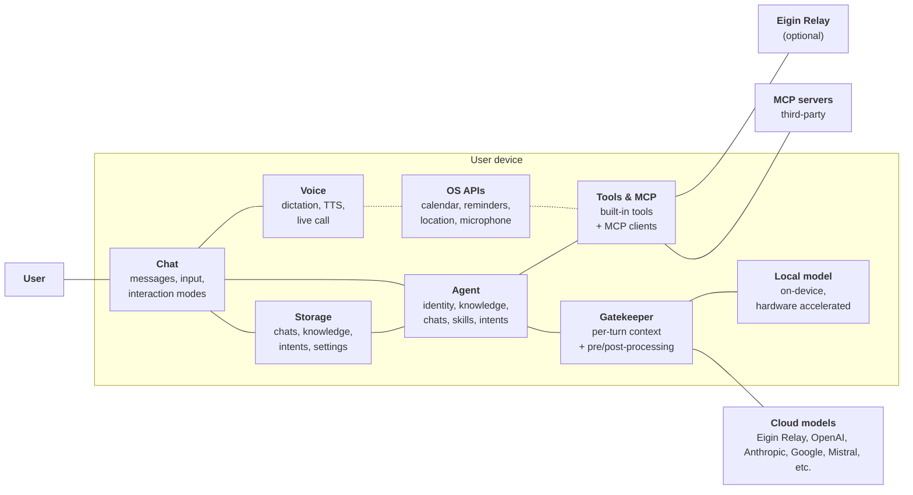

# System context

Eigin at the system level. For platform specifics, see [iOS](./ios/README.md).

## The pieces

### Chat

Where the user meets the agent: a persistent sequence of messages, typed or dictated. Chats live in storage and can be grouped into [spaces](./conversation/spaces.md). See [Conversation](./conversation/README.md).

### Agent

A persistent AI personality with its own identity, knowledge, history, and goals. One agent runs per device. See [The Agent](./agents/README.md).

### Gatekeeper

Sits between the agent and the provider. Hydrates each turn with dynamic context (skills, intents, interaction mode, space, hints) and is the seam for future input/output safety work. See [The gatekeeper](./conversation/context.md).

### Storage

Chats, knowledge, intents, settings, and provider config live on the device.

### Voice

On-device speech recognition, text-to-speech, and a half-duplex live call mode. See [Voice](./voice/README.md).

### Tools and MCP

How the agent acts: built-in tools that integrate with the OS and internet, plus MCP clients for external servers. Both flow through the same permission model. See [Tools](./tools/README.md) and [MCP servers](./tools/mcp.md).

### Inference providers

The agent calls one of two provider kinds:

- **Cloud**: remote inference through [Eigin Relay](./relay.md) or any OpenAI-compatible API.
- **Local**: a hardware-accelerated on-device model. No network required.

See [Inference providers](./providers.md).

### Eigin Relay

Eigin's optional connectivity service and AI inference proxy, for features that need server-side keys the app can't ship. See [Eigin Relay](./relay.md).
