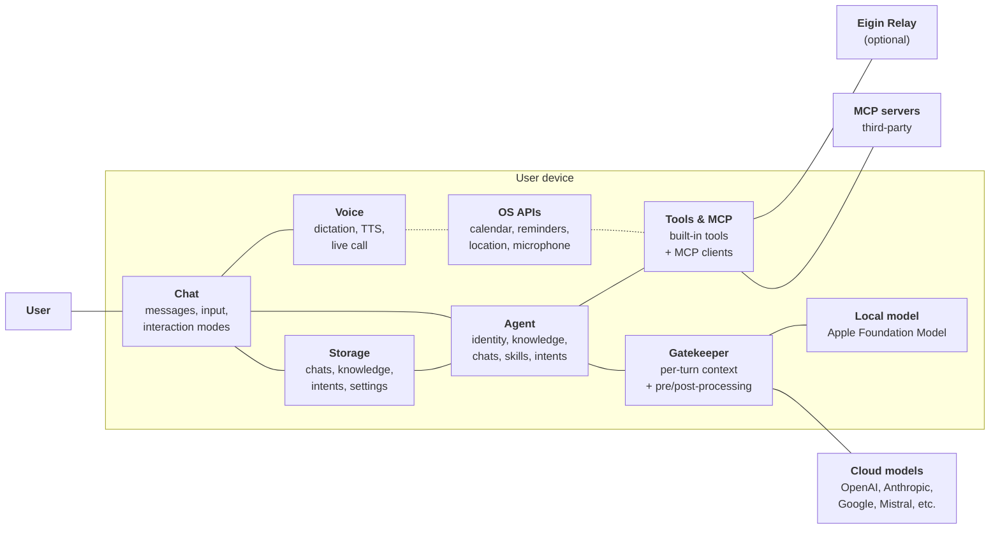

# System context

Eigin is a personal AI agent that runs on the user's device. There is no Eigin account and no Eigin-hosted data store: chats, knowledge, intents, and settings live on the device.

When the agent makes a model call, the request goes from the device to the inference provider the user chose, with the user's API key. Eigin is not in the middle.

The one Eigin-operated network component is the optional **Eigin Relay**, which brokers a small set of third-party features like web search. It never sees chat content or personal data.

This page describes Eigin at the system level. Implementation details for a specific platform live under [iOS Implementation](./ios/README.md).

## The pieces

### Chat

Where the user meets the agent. A chat is a persistent sequence of messages; the user can type directly or dictate through the voice subsystem. Chats live in storage and can be grouped into [spaces](./conversation/spaces.md). See [Conversation](./conversation/README.md).

### The agent

A persistent AI personality with its own identity, knowledge, conversation history, and goals. A device runs one agent at a time. See [The Agent](./agents/README.md).

### Gatekeeper

Sits between the agent and the inference provider. Hydrates each turn with dynamic context (skills, intents, interaction mode, space, hints) and is the seam for future input/output safety work. See [The gatekeeper](./conversation/context.md).

### Storage

Chats, knowledge, intents, settings, and provider configuration live on the device. The app does not synchronise this anywhere. Uninstall and the data is gone, unless the user backed it up themselves.

### Voice

Voice is a primary interaction mode. The voice subsystem handles on-device dictation, text-to-speech for the agent's replies, and a half-duplex "live call" mode for hands-free conversation. Speech recognition runs on-device through OS APIs. TTS uses local models for supported languages, falling back to OS voices. See [Voice](./voice/README.md).

### Tools and MCP

Tools are how the agent acts. They split into **built-in tools** the app ships with — knowledge, web, calendar, reminders, email, time, location, and so on — and **MCP clients** that connect to third-party MCP servers the user has added. Built-in tools may reach into the device through OS APIs (calendar, reminders, location) or out to the internet (web search, via the relay). MCP clients reach external MCP servers for tools the app doesn't ship itself. Both kinds flow through the same interface and the same permission model. See [Tools](./tools/README.md) and [MCP servers](./tools/mcp.md).

### Inference providers

The agent doesn't run a model itself. It calls one of two kinds of provider:

- **Cloud**: OpenAI, Anthropic, Google, Mistral, OpenRouter, and any OpenAI-compatible API. The user supplies the key. Requests go from the device to the provider with no Eigin proxy in between.
- **Local**: today, Apple Foundation Model. Runs on-device. No key, no network.

The provider for a given turn is whatever the user has configured for the active agent. See [Inference providers](./providers.md).

### Eigin Relay

A small, optional service operated by 42futures. It exists for features that need a third-party API key the app can't ship to every user. Today it brokers web search. Later, things like cross-device sync.

The relay only sees the request the agent makes (e.g. a search query). It never sees chat content or personal data. If the agent doesn't use a relay-backed feature, the relay is never contacted. See [Eigin Relay](./relay.md).

## What this means in practice

- **No Eigin account.** You don't sign up.
- **No Eigin data store.** Your data lives on the device, not on a server.
- **No telemetry.** Eigin doesn't phone home.
- **You bring the keys.** Provider API keys live on your device.
- **The relay is optional and narrow.** Today it only brokers web search.
- **One platform today.** The iOS app is the only Eigin app. The architecture leaves room for others.
